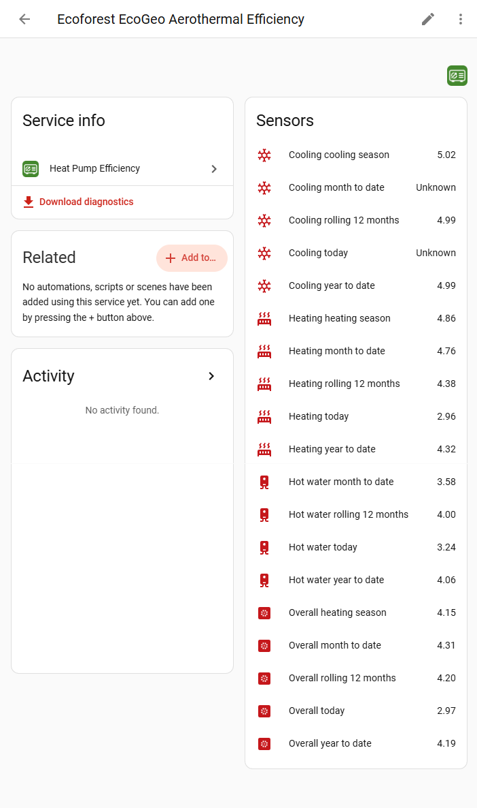

# Heat Pump Efficiency

A Home Assistant custom integration that shows a heat pump's real efficiency over any period (today, month to
date, year to date, rolling 12 months, and per day and per month) as a ratio of energy changes taken from Home
Assistant's long-term statistics. It never averages live COP readings over time.

It is universal: you map your own energy statistics (heat output and electricity, per service and for Overall) in the setup UI.
It only reads statistics. It never imports, adjusts or clears statistics, never calls services of other
integrations and never controls a heat pump. Cost is not part of the integration: it shows efficiency only and
creates no cost entities.



*The author's own installation (an Ecoforest ecoGEO heat pump), shown as an example. On another installation the device and sensor names follow the name you give the integration entry.*

## Status

Version 0.2.0. The integration is installable through the Home Assistant Marketplace from its GitHub link (see Installation).

It declares the Bronze tier of Home Assistant's Integration Quality Scale. The record of every rule, with the reason for each exemption and open item, is in [quality_scale.yaml](custom_components/heatpump_efficiency/quality_scale.yaml).

## Use cases

- See what your heat pump really delivered per kWh of electricity today, this month, this year and over the last
  12 months, the way your meters count it.
- Follow the efficiency of each service (Heating, Hot water, Cooling) and of the whole unit (Overall) separately. A
  cooling figure, especially in BTU/Wh, is not comparable with a heating figure.
- Follow the efficiency per day and per month in a chart, and per heating or cooling season in a table (see
  "Example dashboard cards"), for example to see the effect of a changed setting or a service visit.
- Measure a seasonal performance factor of your own installation, as it really ran, next to the rated SCOP or SEER
  of the data sheet (see "Measured versus rated SCOP and SEER").
- Correct the efficiency for the heat a defrost takes from the circuit, when you have a statistic for it (see "The
  defrost correction").

## Supported heat pumps

Any heat pump or installation for which Home Assistant has energy statistics of both the heat it delivers and the
electricity it uses, for example from the heat pump's own counters or from a heat meter and an electricity meter. You
map those statistics yourself in the setup UI; the integration is not tied to a make or model, talks to no device
and needs no cloud account. The statistics must be energy statistics with a running sum, in kWh or another energy
unit (see "Choosing statistics"). A heat pump without such counters cannot be used. If you only have power
sensors (W), Home Assistant's Integral helper (a Riemann sum integral) can create an energy sensor from them. One example mapping is shown
under "Example: Ecoforest ecoGEO with the author's ESPHome firmware".

## Installation

Requires Home Assistant 2026.11.0 or newer and the recorder (on by default).

- **Home Assistant Marketplace:** open Settings, Marketplace, choose Add from link, enter this repository's GitHub
  link (`https://github.com/peeter123/ha-heatpump-efficiency`) and choose Add. If GitHub is not connected yet, you
  are asked to connect it first; if it asks for the Type, choose Integration. Then open the repository, choose
  Install and restart Home Assistant when it asks. HACS is now built into Home Assistant as the Marketplace, and
  existing HACS installs move over by themselves.
- **Manual copy:** copy the folder `custom_components/heatpump_efficiency` of this repository into the
  `custom_components` folder of your Home Assistant configuration (next to `configuration.yaml`) and restart Home
  Assistant.

After the restart go to Settings, Devices & services, Add integration, and search for "Heat Pump Efficiency".

## Setup

Add the integration once per heat pump (a second heat pump is a second entry with its own name and mapping). The
form has a name and five sections; Heating and Overall are expanded, the others are collapsed until you open them.
Home Assistant needs no YAML.

- **Name:** the name of this heat pump. It becomes the name of the entry and of its device.
- **Heating**, **Hot water**, **Cooling** and **Overall:** one section each, with the same three fields (Cooling
  has a fourth, the unit; Heating and Hot water have a fourth, the defrost heat). A service
  you leave empty is not configured and gets no sensors; at least one section must be filled. Overall can use a
  whole-unit meter that includes standby. The fields of each section:
  - **Output energy statistics:** one or more statistics of the heat delivered (for Cooling, the cooling energy
    delivered, that is the heat removed). Several are added together.
  - **Electrical energy statistics:** one or more statistics of the electricity used for that service. Several are
    added together. Required as soon as an output statistic is chosen, and the reverse.
  - **Measured since:** optional. The first day for which the history is measured rather than estimated. It is
    used only to mark daily and monthly points and periods as including estimated history (see Estimated marks
    below); leave it empty when all history is measured. A date
    set on a service without statistics is not kept, because that service is not configured.
  - **Cooling efficiency unit:** only in the Cooling section. **W/W** (the default) or **BTU/Wh**, where
    BTU/Wh = W/W x 3.412142 (1 W = 3.412142 BTU/h). The unit applies to every Cooling efficiency figure; Overall
    always stays in W/W. W/W is not stored, so a unit alone does not configure Cooling, and a BTU/Wh choice is
    dropped when Cooling is left empty. See Changing the cooling unit below.
  - **Defrost heat statistics:** only in the Heating and Hot water sections, optional. One or more statistics of the
    heat a defrost takes from that circuit (energy with a running sum). Several are added together. With one
    mapped, the efficiency of that service and of Overall is corrected: see "The defrost correction" under
    Definitions, and "Sensors" for the attributes it adds. The field alone does not configure the service (a
    Heating section with only a defrost statistic gets no Heating sensors, and its measured-since date is not
    kept), but it corrects Overall when Overall is configured. Where to map it:
    - A unit that always takes its defrost heat from one circuit by a setting maps the statistic under that
      service.
    - A reverse-cycle unit takes the heat from whichever circuit is active, so split counters are mapped one per
      service. A single counter maps under the dominant service: Overall, which subtracts the sum of both
      sections, stays exact, and the split between Heating and Hot water is then approximate.
    - A heat meter on the water side that counts the heat flowing back in both directions already subtracts the
      defrost heat: leave the field empty for it. Mapping a defrost statistic as well would correct the same heat
      twice, and the integration cannot tell.
    - A statistic may be mapped only once: the same one in both sections, or one that is also an output or
      electrical statistic, is rejected.
    - **Entries from earlier versions:** an entry created while a separate slot held a defrost heat statistic gets
      that statistic moved once into this field of the Heating section, when it is first loaded by a version that
      has the field; every other mapped value stays as it is. The Heating figures are then corrected as soon as the entry
      loads, so check that the statistic belongs under Heating and move it to Hot water in Configure if not. If
      Heating is not configured, the moved statistic corrects only Overall; if neither Heating nor Overall is
      configured it corrects nothing, and Configure shows the "the defrost heat statistics of this section correct
      nothing" error on the next save. A slot value that is also an output or electrical statistic of the entry is
      dropped instead of moved, since it would subtract a statistic that service already counts. A price source
      stored by an earlier version, which nothing ever used, is dropped once when the entry is first loaded by
      this version.
- **Season dates:** a collapsed section (it expands only when it has an error) with the first and the last day of
  the heating season and of the cooling season. Each date is a month (a dropdown) and a day (1 to 31):
  - **Heating season starts: month** and **Heating season starts: day**
  - **Heating season ends: month** and **Heating season ends: day**
  - **Cooling season starts: month** and **Cooling season starts: day**
  - **Cooling season ends: month** and **Cooling season ends: day**

  The dates recur every year and both days belong to the season. A season whose start is later in the year than
  its end crosses the new year (the default heating season in the north). The form is filled in from Home
  Assistant's latitude: in the northern hemisphere (a latitude of 0 or more, also when none is set) the heating
  season is 1 October to 30 April and the cooling season 1 June to 30 September; in the southern hemisphere
  the heating season is 1 April to 31 October and the cooling season 1 December to 28 February. An end on 28
  February includes 29 February in a leap year. 29 February itself is not allowed, a day that does not exist
  in its month (such as 31 April) is rejected, and the start and the end of a season must differ; all four dates must be filled in (an empty month or day is an error); the form
  shows an error on the section and stores nothing. An entry created before the season dates existed gets the
  defaults for the latitude once, when it is first loaded by a version that has them; its mapping does not
  change. The defaults are stored, so moving the home location later does not move the seasons.

A second heat pump must use its own output statistics. When an output statistic you choose, in any section
including Overall, is already an output statistic of another entry of the integration, the setup ends with the
message "This heat pump is already configured: another entry of this integration already uses these output
statistics:" followed by the shared statistics, and no entry is created. Output statistics shared between the
sections of the same heat pump (for example Overall reusing the Heating output), and electrical or defrost
statistics, do not count. The check runs only when a heat pump is added, not when you change an existing entry in
Configure.

### Choosing statistics

Choose statistics, not entities: the list shows every statistic the recorder knows, including external statistics
imported by another integration (for example a utility meter import). A chosen statistic must

- exist in the recorder,
- be an energy statistic (kWh, Wh, MWh and so on; a power statistic in W is rejected), and
- have a running sum (a statistic with only a mean is rejected).

The form is shown again with an error on each section that has a problem. A section shows only its first
problem, in this order: a statistic that does not exist, a statistic that is not an energy statistic, a statistic
without a running sum, electricity missing, output missing, a defrost statistic mapped twice, a defrost statistic
that corrects nothing. A defrost-only section gets neither the electricity nor the output error. The message names the failing statistics, grouped by section (for example `heating: sensor.a; cooling: sensor.b`), and fixing
one problem may reveal the next. A form with nothing mapped asks for at least one service; a defrost statistic
alone maps nothing. The two defrost errors are shown on the section of the defrost field:
**a defrost heat statistic may be mapped only once** (the same statistic in Heating and Hot water, or also chosen
as an output or electrical statistic; the message names it) and **the defrost heat statistics of this section
correct nothing** (the service is not configured and Overall is not either). Mapping a defrost statistic under a
service that is not configured is fine when Overall is configured, because Overall subtracts it. An external statistic has only hourly values, so its service is read hourly; see
the definitions below.

An example mapping uses generic names such as `sensor.heat_pump_heat_energy` (output) and
`sensor.heat_pump_electric_energy` (electricity) for Heating.

### Example: Ecoforest ecoGEO with the author's ESPHome firmware

This is one real mapping, shown as an example only; every other heat pump maps its own statistics. The author's own ESPHome firmware for the ecoGEO, which is not public, exposes total energy sensors (kWh, total increasing) that map like this. The entity
IDs depend on the device name you chose, so they are written here as `sensor.<device>_...` (the names after the
device part are the firmware's entity names as slugs).

| Service | Output energy | Electrical energy |
|---|---|---|
| Heating | `sensor.<device>_total_heating_energy_dg1` | `sensor.<device>_total_electrical_energy_dg1` |
| Hot water | `sensor.<device>_total_heating_energy_dhw` | `sensor.<device>_total_electrical_energy_dhw` |
| Cooling | `sensor.<device>_total_cooling_energy` | `sensor.<device>_total_electrical_energy_cooling` |
| Overall | `sensor.<device>_total_daily_heating_energy` and `sensor.<device>_total_daily_cooling_energy` | `sensor.<device>_total_metered_energy` |

The firmware can backfill earlier hours into these counters, so the
measured-since date of a service is the date the firmware's own counters started, and earlier hours are copied
or estimated. Set it per service in the form, so that periods reaching before it are marked as estimated.

The firmware's `Total Defrost Energy` counter (`sensor.<device>_total_defrost_energy`) is the defrost heat
statistic of this example, mapped under Heating. It counts since 18 November 2026 and is not backfilled, so
periods and points that start earlier are only partly corrected and are flagged (see "The defrost correction"
under Definitions).

### Changing the cooling unit

When you change the Cooling efficiency unit in Configure and any Cooling sensor already has long-term statistics,
a confirmation step is shown before anything is saved. Home Assistant cannot convert the Cooling sensors' existing
long-term statistics to the new unit: after you save, it reports the unit change as a repair, and offers its fix
in the statistics tools (Settings, Tools, Statistics). Until you fix the statistics there, or change the
unit back, Home Assistant stops compiling new long-term statistics for the affected Cooling sensors. This integration never changes statistics; it
only reads them. The daily, monthly and other Cooling figures this integration calculates follow the new unit
straight away, because they are computed from the energy statistics. Choose Submit in the confirmation step to
save the new unit; close the dialog instead to keep the current one and store nothing. With no Cooling statistics
yet, the change is saved without the step.

### Changing the mapping later

Open the integration, choose Configure on the heat pump, and change the statistics, the defrost heat statistics, the measured-since dates, the
season dates and the Cooling efficiency unit with the same form (without the name). The current values are filled in. The entry reloads when
you save a change, and the sensors then use the new mapping; a service you empty loses its sensors. Sensor entity
IDs belong to the service, not to the statistic, so replacing a meter keeps them. The figures do change, though:
after you map a new meter's output or electrical statistic, the periods start at that statistic's first day,
because the effective start is the latest first hour of the mapped output and electrical statistics (a defrost
statistic never limits it). If you map the old and the new meter together, every
period of that service becomes unknown once the old meter has stopped, because it then has no recent statistics.

## Sensors

Each configured service (Heating, Hot water, Cooling) and Overall gets four period sensors, all under one device
named after the heat pump: **today**, **month to date**, **year to date** and **rolling 12 months**. Heating,
Cooling and Overall also get a **season** sensor (see "Season sensors" below); Hot water has none. A service that
is not configured gets none. The state is the efficiency (a ratio, for example 3.60) with no unit (except Cooling in BTU/Wh, see below), 2 decimals and
state class measurement, so Home Assistant writes no logbook entries for it. It is unknown when the period is
unknown, and unavailable while a statistics read that its value needs has failed (see "Unknown and unavailable"
in the definitions below).

The Cooling sensors (the four periods and the season) show the unit `BTU/Wh` when the Cooling efficiency unit is
BTU/Wh (the figure is the W/W ratio times 3.412142), and no unit when it is W/W, so W/W entities are the same as
before. The other sensors, Overall included, have no unit. The sensors have no device class.

Every sensor has an icon of its service, the same for the four period sensors and the season sensor of that
service, where there is one: `mdi:radiator` for Heating, `mdi:water-boiler` for Hot water, `mdi:snowflake` for
Cooling and `mdi:heat-pump` for Overall. You can choose another icon for an entity in its settings.

The default entity ID follows the device name and the sensor name at the time the entity is first created, for
example `sensor.heat_pump_hot_water_month_to_date` for a heat pump named "Heat Pump" (these names are examples).
The unique ID is `<config entry id>_<service>_<period>` with the service `heating`, `hot_water`, `cooling` or
`overall` and the period `today`, `month_to_date`, `year_to_date` or `rolling_12_months`; a season sensor uses
`heating_season` (Heating and Overall) or `cooling_season` (Cooling) as its last part, for example
`<config entry id>_overall_heating_season`. So entity IDs and
history survive changes to the mapping. When you remove a service from the mapping, its sensors are removed from
the entity registry at the next load.

Attributes of every sensor:

- `output_energy` and `electrical_energy`: the summed energies of the period in kWh with 3 decimals, also when the
  efficiency is unknown because of the 0.1 kWh rule. `output_energy` is always the measured output, also when a
  defrost correction applies.
- `period_start`: the start of the period as an ISO timestamp in the Home Assistant time zone, after the period
  start limit (the effective start).
- `includes_estimated`: true when the period starts before the measured-since date of its service.

When a defrost heat statistic is mapped for a service (see "The defrost correction" under Definitions), the
Heating, Hot water and Overall sensors, season sensors included, have three more attributes; Cooling and services
without a defrost statistic never have them:

- `defrost_energy`: the summed defrost heat of the period in kWh with 3 decimals, null when it is unknown.
- `efficiency_uncorrected`: the efficiency without the correction, output over electricity, by the same rules as
  the efficiency (null when an energy is unknown or the electricity is below 0.1 kWh).
- `defrost_since`: the point from which its defrost statistics are counted, the end of the latest first statistics
  hour of its defrost statistics, as an ISO timestamp in the Home Assistant time zone. It is present only when the
  period starts before that point, so the period is partly uncorrected.

The state equals (`output_energy` - `defrost_energy`) / `electrical_energy` up to rounding. All three are recorded
like `output_energy`.

The **today** sensor also has `daily` and the **month to date** sensor `monthly`: lists of points
`{"start": ISO timestamp, "efficiency": number, "estimated": true or false}` for the last 31 days and the last 24
months. With a defrost statistic mapped, each point also has `"defrost_partial": true or false`: true when the
point starts before the point from which its defrost statistics are counted (the end of the latest first
statistics hour of those statistics), so its correction is partial. These two
attributes are excluded from the recorder (they are large), so they are not in the history database; only the
current state carries them.

### Season sensors

The Heating, Overall and Cooling season sensors show the efficiency of a whole season (see "Seasons" under
Definitions): the heating season for Heating and Overall, the cooling season for Cooling. While a season runs the
sensor is that season so far; between seasons it is the last finished season; it is unknown before the first
season has begun within the mapped history, when the efficiency of the season is unknown, or when the entry has
no valid season dates; it is unavailable while a read that the shown season needs has failed (see "Unknown and
unavailable"). The sensor has no attributes when no season has begun, when the entry has no valid season
dates, or while it is unavailable. With a dead mapped statistic (no current rows) it keeps its attributes and
`seasons`: seasons not yet read show null figures, and finished seasons read earlier keep their figures until the
entry is reloaded. A season that has begun but whose efficiency is unknown keeps its
attributes, with its efficiency null in `seasons`. The state has 2 decimals, state class
measurement and, for Cooling in BTU/Wh, the unit `BTU/Wh`.

Attributes of a season sensor, besides the `output_energy`, `electrical_energy`, `period_start` and
`includes_estimated` of the other sensors (here `period_start` is the covered start of the season):

- `season_end`: the natural end of the season, as an ISO timestamp in the Home Assistant time zone.
- `complete`: true when the start of the season is not cut by the start of the mapped history.
- `ended`: true when the season is finished.
- `seasons`: the history of every season from the first one in the mapped history, oldest first, as points
  `{"start", "end", "efficiency", "output_energy", "electrical_energy", "estimated", "complete", "ended"}`
  (`efficiency` is null when unknown). With a defrost statistic mapped, each point also has `defrost_energy` (kWh,
  3 decimals, null when unknown) and `defrost_partial` (true when the season starts before the point from which
  its defrost statistics are counted, the end of the latest first statistics hour of those statistics). The attribute is excluded from the recorder, so it is not in the history
  database; only the current state carries it.

**Measured versus rated SCOP and SEER.** A season sensor is the measured seasonal figure, a ratio of the heat
or cooling energy to the electrical energy of the season (a seasonal performance factor as the installation
really ran, including its defrosting, pumps and standby as far as the mapped meters count them). It is not the
rated SCOP (heating) or SEER (cooling) of a data sheet, which is calculated for standard climates, load profiles
and temperatures; the two differ, and the measured value is the one that matches your bill. The Cooling season
figure is in the Cooling unit of the setup.

### Update timing and caching

The sensors update every 5 minutes at second 30 (for example 12:05:30), 20 seconds after Home Assistant has
compiled the 5-minute statistics, and once when the integration loads or reloads. Each update reads today's
5-minute statistics, so a value is at most about one 5-minute period old. Every period of a service or Overall
ends at the last statistics that all its mapped statistics have (see "Periods end at the last common statistics"
below). A service or Overall that uses an external statistic is read from hourly statistics instead and ends at
its last hourly statistic.

Completed history is cached. Completed months are read when the integration loads and then once per month, and
completed days and the first statistics hour of each mapped statistic (with a defrost statistic's baseline) once
per day (at the first update after the day starts). The statistics metadata (which statistics exist, their units, whether they are external) is read at
every update; Home Assistant usually serves it from memory. A read is made again earlier when the window it needs
is no longer inside the cached one (the history of a statistic starts earlier), when its last read failed, or when
it did not cover every mapped statistic yet (a lagging statistic); such a retry happens at every update until it
succeeds. A failed read never breaks the integration: the sensors whose value needs it are unavailable until it
succeeds (see "Unknown and unavailable" in the definitions), every other sensor keeps its figure, and the failure
is logged once at info level (see "Sensors are unavailable" under Troubleshooting).

Finished seasons are not summed from days. Each is computed from the running counters of its statistics at the
season's two boundaries (see "Seasons" under Definitions). A boundary is read when the integration loads or when
its season has just ended, once more at the first update of the following day, and again when a mapped
statistic's first statistics hour moves. A failed read is tried again at the next update. A read made before a
statistic had statistics up to the boundary is tried again at the first update at which it has. A boundary whose
statistic had no hourly statistics in the 31 days before it is not read again: that season stays unknown until
the first statistics hour moves or the entry is reloaded. A missing reading only makes the seasons that need the
boundary unknown. A failed boundary read makes the season sensor unavailable while the shown season needs that
boundary and no earlier read of it is kept; when the read of the following day fails, the figure read before is
kept and the sensor stays available. While the read of today's statistics fails, no boundary is read (the readings need the last statistics
times) and the boundary counts as a failed read, so kept readings stay and a boundary never read is unavailable;
it is read at the first update at which that read works again. Ten updates in a
day therefore read no finished season more than once. The season that is running is summed from the same cached
months, days and today's statistics as year to date.

### After a statistics backfill

When you import or repair older statistics, the first statistics hour of a mapped statistic moves earlier. The
daily refresh at the first update after midnight notices that by itself. To see the change at once, reload the
entry: Settings, Devices & services, the heat pump entry, the menu, Reload. Reloading keeps nothing cached, so
everything is read again. A backfill that rewrites the counters without moving a statistic's first statistics
hour is not noticed by the cached finished seasons: reload the entry after it so they are read again. The
same goes for a backfill that changes the first sum of a defrost statistic without moving its first hour: its
baseline is read again at the daily refresh, but finished seasons keep their cached readings until the entry is
reloaded.

### Example dashboard cards

The entity IDs below are examples; replace them with the entity IDs of your sensors. None of the examples use the
statistics `mean`: an average of efficiencies is not the efficiency of a period, so the charts read the points the
integration already computed.

Entity cards, one per period:

```yaml
type: entities
title: Hot water efficiency
entities:
  - entity: sensor.heat_pump_hot_water_today
    name: Today
  - entity: sensor.heat_pump_hot_water_month_to_date
    name: Month to date
  - entity: sensor.heat_pump_hot_water_year_to_date
    name: Year to date
  - entity: sensor.heat_pump_hot_water_rolling_12_months
    name: Rolling 12 months
```

Per-day chart with the custom [apexcharts-card](https://github.com/RomRider/apexcharts-card) (install it from
the Marketplace first). Its `data_generator` builds the points from the `daily` attribute: a JavaScript function body that
returns `[timestamp in ms, value]` pairs.

```yaml
type: custom:apexcharts-card
header:
  show: true
  title: Hot water efficiency per day
graph_span: 31d
span:
  end: day
series:
  - entity: sensor.heat_pump_hot_water_today
    type: column
    data_generator: |
      return (entity.attributes.daily || []).map((p) => {
        return [new Date(p.start).getTime(), p.efficiency];
      });
```

Per-month chart from the `monthly` attribute:

```yaml
type: custom:apexcharts-card
header:
  show: true
  title: Hot water efficiency per month
graph_span: 2y
span:
  end: month
series:
  - entity: sensor.heat_pump_hot_water_month_to_date
    type: column
    data_generator: |
      return (entity.attributes.monthly || []).map((p) => {
        return [new Date(p.start).getTime(), p.efficiency];
      });
```

Per-season table with a markdown card: one row per season and service, from the `seasons` attribute of the season
sensors. The label comes from the season's natural dates: its year, or the years it spans for a season that crosses the
new year (this card assumes the heating season does and the cooling season does not). A season cut by the history
start is flagged with its covered start, and a running one as running. Remove the rows of services that are not configured, and the "Defrost partial" legend line when no defrost statistic is mapped.

```yaml
type: markdown
title: Efficiency per season
content: |
  
  
  
  
  
  
  
  {%- set notes = ([] if p.complete else ['from ' ~ as_datetime(p.start).strftime('%-d %b %Y')]) + ([] if p.ended else ['running']) + (['estimated'] if p.estimated else []) + (['defrost partial'] if p.defrost_partial | default(false) else []) -%}
  {%- set ns.rows = ns.rows + [{'key': y ~ ('0' if name == 'Cooling' else i), 'season': label, 'name': name, 'eff': '%.2f' | format(p.efficiency) if p.efficiency is not none else 'unknown', 'out': '%.1f' | format(p.output_energy) if p.output_energy is not none else 'unknown', 'el': '%.2f' | format(p.electrical_energy) if p.electrical_energy is not none else 'unknown', 'notes': notes | join(', ')}] -%}
  
  
  | Season | Service | Efficiency | Output (kWh) | Electricity (kWh) | Notes |
  |:--|:--|--:|--:|--:|:--|
  
  | {{ r.season }} | {{ r.name }} | {{ r.eff }} | {{ r.out }} | {{ r.el }} | {{ r.notes }} |
  
  Estimated: includes history from before the measured-since date.
  Defrost partial: the season starts before its defrost statistics are counted (from the end of their first statistics hour), so it is only partly corrected.
```

The `defrost_partial` mark appears only on points of a service with a defrost statistic mapped (see the season
point fields above); the other points have no such key, which the card's `default(false)` handles (the markdown card renders
templates in strict mode, where an undefined key is an error).

### Example automation

This automation sends a persistent notification when the month-to-date Heating efficiency falls below 3. The entity
ID is an example: find the real one under Settings, Devices & services, by opening the heat pump entry and its
device. A `numeric_state` trigger does not fire while the sensor is unknown or unavailable, so a period that is
unknown or unavailable sends nothing.

```yaml
alias: Heat pump efficiency is low
triggers:
  - trigger: numeric_state
    entity_id: sensor.heat_pump_heating_month_to_date
    below: 3
actions:
  - action: persistent_notification.create
    data:
      title: Heat pump efficiency
      message: >-
        The month-to-date Heating efficiency is {{ states('sensor.heat_pump_heating_month_to_date') | float | round(2) }}.
```


## Removing the integration

1. Go to Settings, Devices & services, open the heat pump entry, open its menu and choose Delete. This removes the
   entry, its device, its sensors and its repair issues. Do this for every heat pump entry. When you delete the last
   entry and the integration came from the Marketplace, Home Assistant asks "Also uninstall Heat Pump Efficiency?":
   choose Uninstall to skip step 2.
2. Remove the files, depending on how you installed it:
   - **Marketplace:** open Settings, Marketplace, open the repository, and choose Uninstall in its menu. If an entry
     is still set up, the Marketplace offers "Delete and uninstall", which deletes its entries with their devices
     and entities and uninstalls the integration.
   - **Manual copy:** delete the folder `custom_components/heatpump_efficiency`.
3. Restart Home Assistant. This is needed also after uninstalling through the Marketplace.

The long-term statistics of the removed sensors stay in the recorder: Home Assistant never purges long-term
statistics by itself, and the `purge_keep_days` option of the recorder does not apply to them. The integration never
changes statistics, so it does not delete them either. To remove them, open Settings, Tools, Statistics, select the
statistics of the removed sensors and choose Delete selected statistics. The statistics you mapped, which belong to other integrations, are not
touched by removing this one.

## Known limitations

- **Delay of about 5 minutes.** The sensors update every 5 minutes, after Home Assistant has compiled the 5-minute
  statistics, so a value is at most about one 5-minute period old (see "Update timing and caching").
- **External statistics are read hourly.** A service or Overall that uses an external statistic (one imported by
  another integration, not recorded from an entity) is read from hourly statistics, so its figures end at its last
  hourly statistic. Such a statistic must be at most 2 hours behind, or a repair issue is raised (see "External
  statistics must be at most 2 hours behind").
- **No cost figures.** The integration shows efficiency only. It has no price source and creates no cost entities.
- **Only as good as the mapped counters.** The efficiency is a ratio of the energy changes of the statistics you
  map. A meter that misses energy, includes or leaves out standby, restarts at 0 or has estimated history gives a figure that
  reflects that (see "A statistic restarts at 0" and "Estimated marks").
- **Short periods.** The defrost correction is meant for a day or longer; there is no hourly figure (see "Valid per
  day or longer").
- **Measured, not rated.** A season sensor is the measured figure of your installation, not the rated SCOP or SEER
  of a data sheet.
- **Cooling unit change.** When the Cooling sensors already have long-term statistics, changing the Cooling
  efficiency unit makes Home Assistant stop compiling new long-term statistics for them until you fix the
  statistics or change the unit back (see "Changing the cooling unit").

## Troubleshooting

### Repair issues

The integration checks every mapped statistic after each update (every 5 minutes) and raises one repair issue per
heat pump and statistic that has a problem. Find them under Settings, System, Repairs. Each issue names the heat
pump and the statistic, and disappears by itself at the next check once the problem is gone, when the mapping is
changed so the statistic is no longer used, or when the heat pump's entry is removed. The issues cannot be fixed
from the Repairs screen; they tell you what to change. Every mapped statistic of every configured service is
checked: the output, the electrical and the defrost statistics. A defrost statistic that corrects nothing (its
service is not configured and Overall is not either) is not checked.

- **Statistic missing for (heat pump):** the mapped statistic no longer exists, for example because the entity was
  renamed or removed. Open the heat pump entry, choose Configure and map a statistic that exists. The sensors that
  use it are unknown meanwhile, not unavailable: reading a statistic that does not exist is not a failed read.
- **Statistic is not an energy statistic for (heat pump):** the statistic's unit is not an energy unit, for
  example power in W. Map an energy statistic instead, or restore the energy unit of the source. If the unit of a
  sensor changes to a non-energy unit, Home Assistant stops writing its statistics and keeps the energy unit in
  the statistic's metadata until you fix the statistics (Settings, Tools, Statistics), so you first see
  "Statistic stopped updating" after 2 hours, not this issue.
- **Statistic has no running sum for (heat pump):** the statistic only has a mean (or similar) and no running sum,
  so energy changes cannot be calculated. Map a statistic with a running sum, such as a total increasing energy
  sensor.
- **Statistic stopped updating for (heat pump):** the statistic has had no new statistics for more than 2 hours;
  the issue shows its last statistics time. Check the device or integration behind it. Until it reports again, every
  period of that service or Overall ends at that time (its other counters are cut there too), and is unknown when
  that time is before today.
- **Statistic has no recent statistics for (heat pump):** the statistic has had no statistics today or in the
  last 3 hours, so there is no last statistics time to show. Check the device or integration behind it, and that
  it still records statistics. The sensors of that service or Overall are unknown until it reports.

The checks run in this order: missing, not an energy statistic, no running sum, stopped. A statistic is reported
under the first problem that applies. The statistics metadata is read at every update, so a statistic that is
renamed, changes its unit or exists again is noticed at the next check. Until Home Assistant has read the
statistics metadata once, nothing is classified and no issue is raised; only the issues of statistics that are no
longer mapped are removed then. A statistic whose read failed is not reported as stopped.

### External statistics must be at most 2 hours behind

A statistic imported by another integration (an external statistic) has only hourly statistics, and the check
uses its last hourly statistic. It must be at most 2 hours behind: an external statistic that is routinely later
than that (for example a utility import that arrives a day late) raises "Statistic stopped updating" and ends
every period of its service or Overall at its last hourly statistic, leaving them unknown when that is before
today; while it lasts the daily points and the current month's point are missing too. Map statistics that are
kept up to date instead.

### A statistic restarts at 0

When a mapped statistic restarts at 0 and a gap follows (no earlier 5-minute statistic remains after a long
outage), the first 5-minute change after the gap equals its whole running sum instead of the energy used. This is
rare. Such a change appears as an unusually large energy in the periods that include it. If a figure looks wrong,
repair the statistic's history with Home Assistant's statistics tools (this integration never changes
statistics).

### Sensors are unavailable

A sensor is unavailable while a statistics read that its value needs has failed (see "Unknown and unavailable"
in the definitions); the sensors that do not need that read stay available. Each failure is logged once, at info
level, when the read fails or its error changes, and once when it works again, for example:

```
Statistics read 'month' failed: RuntimeError: database busy
Statistics read 'month' works again
```

The name is the read: `month`, `day`, `hour` or `5minute` (a table of statistics), `metadata`, `first_hours` or
`boundaries` (the season boundaries). Home Assistant logs only warnings and errors by default, so to see these
lines set the log level of the integration to info, for example in `configuration.yaml`:

```yaml
logger:
  logs:
    custom_components.heatpump_efficiency: info
```

The sensors return at the first update (every 5 minutes) at which the read succeeds. If a read keeps failing, the
error in the line and the last error of every read in the diagnostics (see below) tell why.

### Diagnostics

Download diagnostics from the entry's menu (Settings, Devices & services, the heat pump entry, the three dots,
Download diagnostics) to see the options, the metadata of the mapped statistics, the windows of the last reads,
the season dates, the cached energies of every period, the boundary reads of the seasons (instant, readings,
reasons, first hours, read time), the season points of every service with a season, the defrost statistics per service with their start, first
statistics hours and baselines, the defrost
energy, the uncorrected efficiency and `defrost_since` of each period and season of a corrected service, the
statistics whose first-hours read failed at the last attempt, and the last error of every read. Nothing in it is redacted; it holds statistic IDs and energies only. Attach it when you report a problem.

## Definitions

- **Efficiency is a ratio of energy changes.** For a period, efficiency is the sum of the change of the mapped
  output (heat) statistics divided by the sum of the change of the mapped electrical statistics over that period,
  with all energies in kWh. For example 180.0 kWh of heat from 50.0 kWh of electricity is 3.60. Several output
  statistics (for example for Overall) are summed first. The result has 2 decimals.
- **Not a time average.** A day whose hot water output rose by 8.91 kWh and electricity by 2.86 kWh has an
  efficiency of 3.12, even if a live COP sensor averaged 4.0 over that day.
- **The 0.1 kWh rule.** When the electrical change of a period is below 0.1 kWh, the efficiency is unknown, not a
  large number. The output and electrical energies of the period are still shown as attributes.
- **Periods in the Home Assistant time zone.** Every period ends at the latest statistics (normally the last
  5-minute statistics, a few minutes ago) and starts at the start of a day: today on the
  current day, month to date on the 1st, year to date on 1 January, and the rolling 12 months on the same calendar
  day one year earlier (the last day of that month when that day does not exist, so 29 February 2028 starts at
  28 February 2027). On a daylight saving day the periods neither overlap nor leave a gap.
- **When a day starts.** Home Assistant's hourly statistics start on whole UTC hours, so a day starts at the first
  whole UTC hour at or after local midnight. In most time zones that is local midnight. In a time zone whose offset
  is not a whole number of hours it is later: 00:30 in Asia/Kolkata (UTC+05:30), so there today, month to date,
  year to date and the rolling 12 months start at 00:30, and until 00:30 today is still the previous day. On a day
  whose local midnight does not exist (the clocks jump from 00:00 to 01:00) the day starts at its first existing
  hour. No energy around midnight is missed or counted twice.
- **Period start limited to the mapped history.** When the first statistics hour of a mapped output or electrical
  statistic lies after a period's start, the period starts at the first day start at or after the latest first
  statistics hour among the output and electrical statistics of that service or Overall. A history starting
  13 November at 14:00 gives 14 November 00:00, so no heat without matching electricity is counted. The sensor
  reports that effective start. A defrost statistic never limits it (see "Defrost history never limits a period").
  When the limited period has not begun yet (for example the history starts today at 09:00), the sensor is unknown
  until tomorrow. This also holds for an output or electrical statistic so new that it has no hourly statistics
  yet, only 5-minute ones: its service or Overall is unknown until the first update of the next day reads its first
  statistics hour, never a figure from the other counters' whole history. The daily
  and monthly series are limited the same way. A defrost statistic with only 5-minute statistics does not make
  its service unknown: its heat is subtracted and the periods are flagged (see "Defrost history never limits a
  period"). When a backfill later extends the history, the periods are unknown
  until the older statistics have been read, and then start at their usual start.
- **Periods end at the last common statistics.** Every period of a service or Overall ends where the statistics of
  all its mapped counters end: at the earliest end of their last statistics, at most now. When one sensor goes
  offline, for example the electricity meter of Heating has had no statistics since 08:20 and it is 10:20, every
  period of Heating ends at 08:20 for both counters, so no heat is counted without matching electricity. The other
  services are not affected. When a mapped statistic has no 5-minute statistics in the last 3 hours and none today
  (no hourly ones for a service read hourly), or its last statistics end before today started, every period of its
  service or Overall is unknown until it reports again.
- **Never a partial figure.** A period is unknown rather than 0 when a statistics read it needs did not cover the
  whole period, or was made before one of its mapped statistics had statistics up to the end of that read (such a
  read is tried again at every update), or when any of its mapped statistics has no statistics at all. While a
  statistics read it needs has failed it is unavailable instead (see "Unknown and unavailable"). Every sensor is
  also unavailable until the statistics metadata has been read successfully once (it tells which statistics are
  external and read hourly); the metadata is read at every update, and a failed read after the first success keeps
  the metadata read before. A figure is never computed from part of its period. A legitimate 0.00 is still shown
  as 0.00.
- **Unknown and unavailable.** A sensor is unknown when every read it needs worked and there is still no figure: the
  period has not begun, a mapped statistic has no data or is behind, a read did not cover the period yet, or the
  electricity is below 0.1 kWh. A sensor is unavailable while a statistics read that its value needs failed at its
  latest attempt, and it shows its figure again at the first update at which that read succeeds. A period sensor
  needs the read of today's statistics of its service or Overall (5-minute statistics, or hourly ones for a service
  read hourly) and the reads of the completed days and months that its period uses; so a failed read of completed
  months makes year to date and rolling 12 months unavailable while today and month to date stay available, and a
  failed read of today's statistics makes every period sensor of the services that read it unavailable. A
  service that reads hourly statistics but also maps a statistic with 5-minute statistics (Overall, for example) is
  unavailable too, for the periods that use completed days or months read at that update, while the 5-minute read
  fails; its other periods stay available. A season
  sensor needs the same reads for a running season, and the boundary reads (the running counters at the season's
  two boundaries) for a finished one, unless an earlier read of a boundary is kept. Every sensor of a service is
  unavailable until the statistics metadata has been read once and, for that service, until the first statistics
  hour of each of its mapped statistics has been read once. A later failure of either keeps the last good values and
  changes nothing. An unavailable sensor has no attributes. An available sensor's series attributes (`daily` and
  `monthly`) can miss the points of a history read while it fails, because availability follows the sensor's own
  value only. An automation that must also react to an unavailable
  sensor has to test for `unavailable` as well as `unknown`.
- **External statistics read hourly.** A statistic imported by another integration (an external statistic) has
  only hourly statistics. A service or Overall that uses one reflects its counters up to the last hour for which
  all its statistics have hourly statistics: at 14:20, with hourly statistics up to 14:00, every period of that
  service or Overall ends at 14:00 for both counters, while the other services end at their last 5-minute
  statistics (14:15).
- **The defrost correction.** When a defrost heat statistic is mapped for Heating or Hot water, the heat a defrost
  takes from the circuit is not useful heat, so the efficiency of that service is (output - defrost heat) /
  electricity, all in kWh: 36.8 kWh of heat with 1.84 kWh of defrost heat from 9.2 kWh of electricity is 3.80
  instead of 4.00. Overall subtracts the defrost heat of both sections: (50.0 - (2.0 + 0.5)) / 12.5 is 3.80.
  Cooling is never corrected, and a defrost statistic of a service that is not configured corrects only Overall.
  Without a defrost statistic nothing changes. The same correction applies to periods, the daily and monthly
  series and seasons; the output energy attribute stays the measured output.
- **Defrost history never limits a period.** A defrost statistic never moves the effective start of its service
  or Overall: year to date on 22 November 2026 still starts on 1 January 2026 when the first statistics hour of the
  defrost statistic is 18 November 2026 at 10:00. It counts from the end of its first statistics hour, with its
  running sum at that point (its first sum) as its baseline: before then it counts as 0 kWh, whatever its first
  sum is, and the energy of the first hour itself is not counted. An external or imported counter that does not
  start at 0 is therefore handled: a counter whose first sum is 500.0 kWh and that has counted 2.0 kWh more by the
  end of that day gives 2.0 kWh of defrost heat for that day, not 502.0, and month to date and year to date
  subtract 2.0 kWh for it. Periods, points and seasons that start before the end of that first hour are
  uncorrected for the earlier part, and are flagged: `defrost_since` is the end of the first hour (18 November 2026
  11:00) on a period that starts before it, `defrost_partial` marks such a daily, monthly or season point (the
  daily point of 18 November is marked, the one of 19 November is not). A finished season before the defrost
  statistic has 0.0 kWh of defrost heat and the same efficiency as without correction; a finished season that
  spans its start counts from the baseline (a first sum of 500.0 kWh on 15 November 2025 at 10:00 and 520.0 kWh at
  the end of the season give 20.0 kWh). A defrost statistic that has only 5-minute statistics yet counts as
  starting now, from 0, so every period and point is flagged until the next day's first update reads its first
  hour and baseline; from then on the energy of that first hour is no longer counted, so that day's defrost
  figure can drop slightly. A service that is read hourly (an external statistic among its statistics) has no hourly
  statistics of a newly mapped defrost statistic until Home Assistant has compiled its first hour, so its figures
  are unknown for at most about an hour.
- **Unknown, never a fallback.** A corrected efficiency is unknown, never the uncorrected figure, when the defrost
  energy of the period is unknown: the defrost statistic is missing or has no statistics, or a read did not cover
  it yet. The defrost statistics count as mapped statistics of their service for the rules above, so a defrost
  statistic that is behind or offline ends every period of its service at its last statistics, an external one
  makes the service read hourly, and a history read made before it had caught up is read again. The uncorrected
  efficiency stays available as an attribute wherever the output and electrical energies are known. A corrected
  output of 0 or less (output minus defrost heat) is unknown too, with the defrost energy still shown.
- **The 0.1 kWh rule stays on electricity.** The corrected efficiency is unknown when the electrical energy is
  below 0.1 kWh (0.05 kWh is unknown); a small corrected output above 0 is a real figure (1.0 kWh of output and
  0.8 kWh of defrost heat over 0.5 kWh of electricity is (1.0 - 0.8) / 0.5 = 0.40).
- **Valid per day or longer.** The defrost heat is counted when the defrost happens, while the reheating after it
  is counted over the following hours, so a figure for a short period can dip right after a defrost. The
  correction is meant for a day or longer; there is no hourly figure.
- **Seasons.** A season runs from the start of its start day to the end of its end day, as statistics days in the
  Home Assistant time zone, and recurs every year; the heating season is used for Heating and Overall and the
  cooling season for Cooling (Hot water has none). With the default northern heating season from 1 October to
  30 April, the season that starts on 1 October 2026 ends at the start of 1 May 2027; a season whose start is
  later in the year than its end crosses the new year. The cooling season from 1 June to 30 September of 2026
  covers 1 June 2026 00:00 up to 1 October 2026 00:00. An end on 28 February includes 29 February in a leap year.
- **A season is a period.** Its efficiency follows the rules above: a ratio of energy changes (9000.0 kWh of heat
  from 2500.0 kWh of electricity is 3.60), the 0.1 kWh rule, and a start limited to the mapped history. When the
  heating season started on 1 October 2026 and the history starts on 13 November 2026 at 14:00, the season is
  computed from 14 November 2026 00:00 and is not complete. While a season runs it ends at the last common
  statistics, like year to date, and is never a partial figure. A season with an unknown efficiency keeps its
  place in the history with the efficiency null and its energies shown.
- **The state between seasons.** While a season runs, a season figure is that season so far (on 15 January 2027:
  1 October 2026 to now). Between seasons it is the last finished season (on 15 July 2027: 1 October 2026 to
  30 April 2027). It is unknown while no season has begun within the mapped history (Cooling statistics that
  start on 13 November 2026 give no cooling season before 1 June 2027). The history lists every season from the
  one that contains the start of the mapped history up to the current or last one, oldest first (statistics that
  start on 1 September 2023, on 15 January 2027 and with the default heating season: the seasons starting
  1 October 2023, 2024, 2025 and 2026).
- **Season flags.** A season is `complete` when its start is not cut by the start of the mapped history, `ended`
  when it is over (its end is at or before the start of today) and `estimated` when its covered start lies before
  the measured-since date of its service, by the rule of the estimated marks below.
- **Finished seasons read once from the counters.** A finished season equals the sum of its days exactly. It is
  computed as the running counter of each statistic at the end minus the counter at the start (the covered start,
  where the history cuts the season), summed per side, so a history of many years costs a few small reads once,
  not a long read of days at every update (see Update timing and caching). The first update after a season ends
  reports it as ended with the whole season, no hour missed or counted twice.
- **Daily and monthly series.** The last 31 days (today so far) and the last 24 calendar months (the current month
  so far), each computed by the same rule. A day or month with an unknown efficiency has no point, not 0.
- **Estimated marks.** When you give a measured-since date for a service or Overall, each daily or monthly point and
  each period sensor whose covered start lies before the start of that date is marked as including estimated
  history. The covered start is the start of the day, month or period, or the effective start where that cuts it.
  Without a date nothing is marked. For example, with measurements since 13 November 2026 the point for November
  2026 and all earlier points are estimated and December 2026 is not; but when the effective start is also
  13 November 2026, the November 2026 point and year to date start on that day and are not estimated.

## Development

There are two sets of tests.

The tests in `tests/` check the pure modules and run anywhere, without Home Assistant. One command runs every local
check: ruff check, ruff format check, those tests under pytest, and a compile check of the Python folders. It needs
[uv](https://docs.astral.sh/uv/), the only program it takes from `PATH` besides Python, and runs every tool at an
exact version through uv. From the repository root run

```sh
python scripts/lint.py
```

It prints the versions it uses, runs every step even after a failure, and exits with 0 when all pass, 1 when a step
fails and 2 when uv is missing or a program cannot be started. Add `--fix` to apply ruff's fixes and the formatter first. The ruff settings are
those of Home Assistant core's `pyproject.toml` at tag 2026.11.2, in `pyproject.toml`.

The Home Assistant tests in `tests_ha/` run the integration inside Home Assistant's test harness
(`pytest-homeassistant`, Home Assistant's own test package). They run in CI, or locally on Linux or macOS, because
the harness does not load on Windows. CI measures the line and branch coverage of the integration over both folders
together. The first command below runs the Home Assistant tests, the second runs the tests in `tests/` and adds to the
same data, the third requires every line and branch of `config_flow.py`, the fourth writes the JSON report, and the
last is the coverage gate. To run them all locally, with uv installed, run from the repository root

```sh
uv run --no-project --python 3.14 --with pytest-homeassistant==2026.11.2 --with pytest-cov==7.1.0 --with coverage==7.16.2 pytest tests_ha -p no:respx --cov=custom_components/heatpump_efficiency --cov-branch --cov-report=
uv run --no-project --python 3.14 --with pytest==9.0.3 --with pytest-asyncio==1.4.0 --with tzdata==2026.6 --with pytest-cov==7.1.0 --with coverage==7.16.2 pytest tests --cov=custom_components/heatpump_efficiency --cov-branch --cov-append --cov-report=term-missing
uv run --no-project --python 3.14 --with pytest-homeassistant==2026.11.2 --with pytest-cov==7.1.0 --with coverage==7.16.2 coverage report --include="*/config_flow.py" --fail-under=100
uv run --no-project --python 3.14 --with pytest-homeassistant==2026.11.2 --with pytest-cov==7.1.0 --with coverage==7.16.2 coverage json -o coverage.json
python scripts/coverage_gate.py coverage.json 95
```

The run of `tests/` uses the pins of `scripts/lint.py` and no Home Assistant. The Home Assistant tests job fails unless
`config_flow.py` has 100 % line and branch coverage, and unless the integration in total and every module under
`custom_components/heatpump_efficiency/` has at least 95 % coverage. The gate (`scripts/coverage_gate.py`, standard
library only) prints each module below the threshold with its percentage and the total, and exits with 0 when they
all reach it, 1 when one does not (or when the report has no file of the integration) and 2 when the report
cannot be read.

GitHub runs four jobs on every push and pull request: hassfest, the HACS action, the lint job (`python
scripts/lint.py`), and the Home Assistant tests.

The brand images in `custom_components/heatpump_efficiency/brand/` (`icon.png` at 256 px and `icon@2x.png` at 512 px)
are generated by `scripts/brand.py`, which draws a white outdoor unit with a fan ring and an arrow to the upper right on a green
rounded tile, using only the Python standard library. The geometry in that script is the icon's source; change it
there and run

```sh
python scripts/brand.py
```

to rewrite both PNG files. An optional argument names another output folder. A test redraws the 256 px icon and
compares it with the committed file.

## License

MIT, see [LICENSE](LICENSE).
